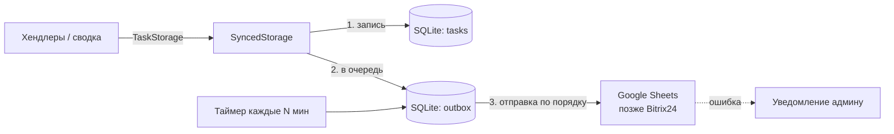
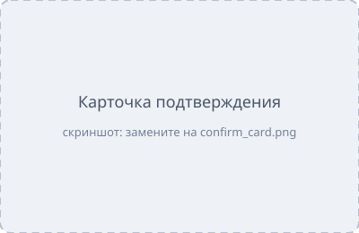
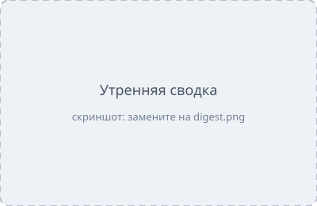

# WindowBot — Telegram-бот для задач по заказам

Бот принимает задачу обычным сообщением в личном чате:

```
Покраска, заказ 123, срок пятница, ответственный Иван
```

разбирает её на поля (тип работ, заказ, срок, ответственный), сохраняет в Google Sheets
(с локальной копией в SQLite) и каждое утро присылает сводку: просроченные задачи и задачи на сегодня.
Для уличных работ (монтаж/демонтаж) проверяет прогноз погоды Open-Meteo.

---

## Содержание

1. [Возможности](#возможности)
2. [Требования](#требования)
3. [Установка Python](#1-установка-python)
4. [Загрузка проекта и зависимостей](#2-загрузка-проекта-и-зависимостей)
5. [Создание Telegram-бота](#3-создание-telegram-бота)
6. [Настройка Google Sheets](#4-настройка-google-sheets)
7. [Настройка .env](#5-настройка-env)
8. [Запуск и проверка](#6-запуск-и-проверка)
9. [Запуск как службы (автозапуск)](#7-запуск-как-службы-автозапуск)
10. [Как пользоваться ботом](#как-пользоваться-ботом)
11. [Что будет, если что-то недоступно](#что-будет-если-что-то-недоступно)
12. [Тесты](#тесты)
13. [Структура проекта](#структура-проекта)
14. [Миграция на Bitrix24](#миграция-на-bitrix24)
15. [Отчёт и архитектура](#отчёт-и-архитектура)
16. [Частые проблемы](#частые-проблемы)

---

## Возможности

- Разбор задачи из текста без LLM: строгий шаблон → мягкий поиск полей → подтверждение кнопками.
- 4 типа работ: **Монтаж, Демонтаж, Покраска, Обслуживание** (+ синонимы: установка, снятие, окраска, ТО, сервис).
- Сроки: дни недели в любом падеже (`пятница`, `до пятницы`, `пт`), `сегодня/завтра/послезавтра`,
  `15.11.2026`, `15.11.26`, `20.11`, со временем — `пятница 12:00`.
  - без времени срок = **18:00**;
  - если срок сегодня = **16:00** (за 2 часа до конца рабочего дня);
  - если сегодня уже после 16:00 — бот предложит выбор кнопками.
- Кнопка **«✅ Выполнено»**: задача остаётся в базе со статусом «Выполнена».
- Хранилище переключается в `.env`: `sheets` (Google Sheets + SQLite) или `sqlite`.
- Если Google Sheets недоступен — задача не теряется: она сохраняется локально, админ получает
  уведомление, очередь досылается автоматически.
- Предупреждение о погоде для монтажа/демонтажа: температура ниже порога, ветер выше порога, любые осадки.
- Утренняя сводка в 9:00 (по времени сервера) — в чат, где создавалась задача.

## Требования

| Что | Зачем |
|---|---|
| Python **3.11+** | язык проекта |
| Доступ в интернет к `api.telegram.org`, `sheets.googleapis.com`, `api.open-meteo.com` | работа бота |
| Аккаунт Telegram | создать бота |
| Аккаунт Google | таблица и сервисный аккаунт (не нужен в режиме `sqlite`) |

---

## 1. Установка Python

Проверьте, установлен ли Python (нужна версия 3.11 или новее):

```bash
python --version
```

Linux/macOS: `python3 --version`. Если версия 3.11+ — переходите к шагу 2.

### Windows

**Вариант А — через winget** (встроен в Windows 10/11):

```bash
winget install --id Python.Python.3.12 -e --scope user
```

**Вариант Б — вручную:** скачайте установщик с https://www.python.org/downloads/windows/,
запустите и **обязательно отметьте галочку «Add python.exe to PATH»**.

После установки **закройте и заново откройте терминал** и проверьте `python --version`.

> Если вместо версии открывается Microsoft Store или ничего не выводится:
> «Параметры → Приложения → Дополнительные параметры приложений → Псевдонимы выполнения приложений» —
> выключите `python.exe` и `python3.exe`, затем откройте новый терминал.

### Linux (Ubuntu/Debian)

```bash
sudo apt update
sudo apt install -y python3 python3-venv python3-pip git
python3 --version
```

Если в вашей версии Ubuntu Python ниже 3.11 (например, Ubuntu 20.04):

```bash
sudo add-apt-repository -y ppa:deadsnakes/ppa
sudo apt install -y python3.12 python3.12-venv
```

и дальше используйте `python3.12` вместо `python3`.

### macOS

```bash
brew install python@3.12
```

(Homebrew: https://brew.sh) или установщик с https://www.python.org/downloads/macos/.

---

## 2. Загрузка проекта и зависимостей

```bash
git clone https://github.com/niyazzz99-gif/WindowBot.git
cd WindowBot
```

Нет git — скачайте ZIP на странице репозитория (**Code → Download ZIP**) и распакуйте.

Создайте виртуальное окружение и установите зависимости:

**Windows (PowerShell):**

```bash
python -m venv .venv
.\.venv\Scripts\python.exe -m pip install --upgrade pip
.\.venv\Scripts\python.exe -m pip install -r requirements.txt
```

**Linux / macOS:**

```bash
python3 -m venv .venv
.venv/bin/python -m pip install --upgrade pip
.venv/bin/python -m pip install -r requirements.txt
```

> Дальше в инструкции команды даны для Windows. На Linux/macOS замените
> `.\.venv\Scripts\python.exe` на `.venv/bin/python`.

---

## 3. Создание Telegram-бота

1. Откройте в Telegram [@BotFather](https://t.me/BotFather) → `/newbot`.
2. Введите отображаемое имя и username бота (должен заканчиваться на `bot`).
3. BotFather пришлёт **токен** вида `1234567890:AA...` — это `BOT_TOKEN`.

> Токен — секрет. Не публикуйте его и не коммитьте. Если токен утёк — `/revoke` в @BotFather.

`ADMIN_CHAT_ID` (куда слать уведомления об ошибках) узнаете после первого запуска:
напишите боту `/myid`.

---

## 4. Настройка Google Sheets

> Пропустите этот шаг, если будете работать в режиме `STORAGE_BACKEND=sqlite`.

Бот работает от имени **сервисного аккаунта** Google — это «технический пользователь» с JSON-ключом.

1. Откройте https://console.cloud.google.com/ → вверху выберите проект или **New Project**
   (например, `WindowBot`) → **Create**.
2. **APIs & Services → Library** → найдите **Google Sheets API** → **Enable**.
3. **IAM & Admin → Service Accounts → Create service account**.
   Имя — любое (например, `windowbot`). Шаги с ролями и доступами можно пропустить → **Done**.
4. Откройте созданный аккаунт → вкладка **Keys → Add key → Create new key → JSON → Create**.
   Скачается файл ключа.
5. В папке проекта создайте папку `credentials` и положите туда файл под именем
   `service_account.json`:

   ```
   WindowBot/credentials/service_account.json
   ```

   Папка `credentials/` в `.gitignore` и в репозиторий не попадёт.
6. Откройте JSON-файл и скопируйте значение `client_email`
   (вида `windowbot@project-id.iam.gserviceaccount.com`).
7. Создайте Google-таблицу (или откройте существующую) → **Настройки доступа** →
   добавьте `client_email` с ролью **Редактор** → **Отправить** (уведомление можно снять).
8. Скопируйте ссылку на таблицу — она понадобится для `SPREADSHEET_ID`.

При первом запуске бот сам создаст в таблице лист **«Задачи»** с заголовками:

| ID | Тип работ | Заказ | Срок | Ответственный | Статус | Создана | Выполнена | Chat ID | Исходный текст |
|---|---|---|---|---|---|---|---|---|---|

Таблицу можно править руками: менять срок, ответственного, ставить статус «Выполнена».
Не меняйте колонку **ID** — по ней бот находит строки.

---

## 5. Настройка .env

Скопируйте шаблон:

```bash
copy .env.example .env
```

(Linux/macOS: `cp .env.example .env`) и откройте `.env` в любом редакторе.

> **Секреты пишите только в `.env`**, не в `.env.example` — шаблон публикуется в репозитории.

| Переменная | Обязательна | Пример | Описание |
|---|---|---|---|
| `BOT_TOKEN` | да | `1234567890:AA...` | токен от @BotFather |
| `ADMIN_CHAT_ID` | нет | `123456789` | chat_id администратора для уведомлений об ошибках (`/myid` в боте) |
| `STORAGE_BACKEND` | нет | `sheets` | `sheets` — Google Sheets + локальная копия; `sqlite` — только локально. По умолчанию `sqlite` |
| `GOOGLE_CREDENTIALS_JSON` | для `sheets` | `credentials/service_account.json` | путь к JSON-ключу **или** сам JSON одной строкой |
| `SPREADSHEET_ID` | для `sheets` | ссылка или ID | можно вставить ссылку на таблицу целиком |
| `SQLITE_PATH` | нет | `data/tasks.db` | файл локальной базы (создаётся сам) |
| `SYNC_INTERVAL_MINUTES` | нет | `5` | как часто досылать в Sheets накопившуюся очередь |
| `WEATHER_LAT` / `WEATHER_LON` | да | `54.7388` / `55.9721` (Уфа) | координаты объектов для прогноза погоды |
| `TEMP_THRESHOLD` | нет | `-10` | предупреждать, если минимальная температура ниже, °C |
| `WIND_THRESHOLD` | нет | `10` | предупреждать, если максимальный ветер выше, м/с |
| `DIGEST_TIME` | нет | `09:00` | время утренней сводки по часам сервера |
| `LOG_LEVEL` | нет | `INFO` | `DEBUG`, `INFO`, `WARNING`, `ERROR` |

Координаты города можно взять на https://www.latlong.net/ или в Google Maps
(правый клик по точке → первая строка меню).

---

## 6. Запуск и проверка

```bash
.\.venv\Scripts\python.exe -m bot.main
```

Успешный запуск выглядит так:

```
INFO    bot.services.storage_factory: Хранилище: Google Sheets 1u7V... + локальная копия data\tasks.db
INFO    bot.scheduler.setup: Часовой пояс планировщика: Europe/Moscow
INFO    bot: Бот запущен
INFO    aiogram.dispatcher: Run polling for bot @your_bot ...
```

Остановка — `Ctrl+C`.

**Проверка за 2 минуты:**

1. Напишите боту `/start`, затем `/myid` → впишите число в `ADMIN_CHAT_ID` в `.env` и перезапустите бота.
2. Отправьте `Покраска, заказ 123, срок пятница, ответственный Иван` — бот ответит
   «✅ Задача сохранена», в таблице появится строка.
3. Нажмите **✅ Выполнено** — в таблице статус сменится на «Выполнена».
4. Отправьте `Монтж, заказ 5, срок завтра` — бот покажет карточку с кнопками выбора типа и правки полей.

Если бот не стартует — сообщение об ошибке в консоли подскажет, что не так в `.env`
(см. [Частые проблемы](#частые-проблемы)).

---

## 7. Запуск как службы (автозапуск)

Чтобы бот работал постоянно и поднимался после перезагрузки сервера.

> Утренняя сводка приходит по **часам сервера**. Проверьте часовой пояс сервера
> (в логе при старте: «Часовой пояс планировщика: ...»). На Linux изменить:
> `sudo timedatectl set-timezone Europe/Moscow`.

### Linux (systemd)

Пример для проекта в `/opt/WindowBot` и пользователя `windowbot`:

```bash
sudo useradd --system --home /opt/WindowBot windowbot
sudo chown -R windowbot: /opt/WindowBot
sudo nano /etc/systemd/system/windowbot.service
```

```ini
[Unit]
Description=WindowBot Telegram bot
After=network-online.target
Wants=network-online.target

[Service]
User=windowbot
WorkingDirectory=/opt/WindowBot
ExecStart=/opt/WindowBot/.venv/bin/python -m bot.main
Restart=always
RestartSec=10

[Install]
WantedBy=multi-user.target
```

```bash
sudo systemctl daemon-reload
sudo systemctl enable --now windowbot
sudo systemctl status windowbot
journalctl -u windowbot -f
```

### Windows (Планировщик задач)

1. Создайте в папке проекта файл `run.bat`:

   ```bat
   @echo off
   cd /d %~dp0
   if not exist data mkdir data
   .venv\Scripts\python.exe -m bot.main >> data\bot.log 2>&1
   ```

2. **Планировщик заданий → Создать задачу**:
   - *Общие:* имя `WindowBot`, «Выполнять вне зависимости от регистрации пользователя»;
   - *Триггеры:* «При запуске»;
   - *Действия:* «Запуск программы» → путь к `run.bat`;
   - *Параметры:* «Если задача завершилась сбоем, перезапускать через 1 мин», снять
     «Останавливать задачу, выполняемую дольше...».

Лог будет в `data\bot.log`.

> Запускайте **только один экземпляр** бота с одним токеном — иначе Telegram вернёт ошибку
> `Conflict: terminated by other getUpdates request`.

---

## Как пользоваться ботом

Бот работает **только в личных сообщениях**.

**Формат задачи:**

```
<тип работ>, заказ <номер>, срок <когда>, ответственный <имя>
```

Если поля идут именно в этом порядке через запятую, слова «срок» и «ответственный»
можно не писать:

```
Покраска, заказ 321, 20.11 12:00, Алекс
```

| Пример | Результат |
|---|---|
| `Покраска, заказ 123, срок пятница, ответственный Иван` | сохраняется сразу |
| `Монтаж окон, заказ №45, срок 15.11.2026, ответственный Пётр Сидоров` | сохраняется сразу |
| `демонтаж; заказ 7-А; срок до среды; ответственная Мария` | сохраняется сразу |
| `Монтаж, заказ 45, 20.11.2026, ответственный Сеня` | сохраняется сразу (слово «срок» можно опустить) |
| `Покраска, заказ 321, 20.11 12:00, Алекс` | сохраняется сразу (короткий формат) |
| `Покраска, заказ 1, ответственный Иван, срок пятница` | карточка подтверждения: поля переставлены |
| `Монтаж, заказ 45, 06.11.2026, ответственный Сеня` | карточка подтверждения: срок в прошлом |
| `Обслуживание заказ 88 срок завтра ответственный Олег` | карточка подтверждения (нет запятых) |
| `Монтж, заказ 5, срок пятница, ответственный Иван` | кнопки выбора типа (опечатка) |
| `Покраска ворот срок понедельник` | карточка: не хватает заказа и ответственного |

В карточке подтверждения: **✏️ Тип / Заказ / Срок / Ответственный** — исправить поле,
**💾 Сохранить** (появляется, когда заполнены все поля), **✖️ Отмена**.

**Команды:**

| Команда | Что делает |
|---|---|
| `/start`, `/help` | формат задач |
| `/tasks` | открытые задачи с кнопками «Выполнено» |
| `/digest` | утренняя сводка прямо сейчас |
| `/cancel` | отменить ввод/черновик |
| `/myid` | показать chat_id (для `ADMIN_CHAT_ID`) |

> Неподтверждённые черновики хранятся в памяти: после перезапуска бота их нужно прислать заново.
> Сохранённые задачи не теряются.

### Погода (монтаж и демонтаж)

Прогноз [Open-Meteo](https://open-meteo.com/) (ключ не нужен) для точки `WEATHER_LAT/WEATHER_LON`.
Предупреждение, если в день срока:

- минимальная температура ниже `TEMP_THRESHOLD` (по умолчанию −10 °C; ровно порог — не предупреждение);
- максимальный ветер выше `WIND_THRESHOLD` (по умолчанию 10 м/с);
- ожидаются любые осадки (дождь или снег, `precipitation_sum > 0`).

Когда проверяется:

- **при создании задачи** — если срок в ближайшие 10 дней (дальше прогноз неточен).
  После «✅ Задача сохранена» приходит отдельное сообщение:
  `⚠️ Погода на пн 09.11: холод до -18 °C (порог -10 °C); осадки 1.2 мм`
  или `🌤 Погода на пн 09.11 без ограничений: от +3 °C, ветер до 3 м/с, без осадков.`;
- **в утренней сводке** — для монтажей/демонтажей на сегодня и завтра.

Покраска и обслуживание погоду не проверяют. Прогноз кэшируется на 30 минут — один запрос
к Open-Meteo на все проверки.

### Утренняя сводка

Каждый день в `DIGEST_TIME` (по умолчанию 9:00 **по часам сервера**) каждый чат получает сводку
только по своим задачам:

```
☀️ Сводка на сб 07.11.2026

🔴 Просрочено (1):
1. Покраска, заказ 101 — чт 05.11.2026 18:00, Иван

🟡 На сегодня (1):
2. Монтаж, заказ 102 — сб 07.11.2026 18:00, Пётр

🌦 Погода для монтажа/демонтажа (сегодня и завтра):
• Монтаж, заказ 102 (сб 07.11): ⚠️ осадки 2.8 мм
• Демонтаж, заказ 103 (вс 08.11): 🌤 без ограничений (от -3 °C, ветер до 2 м/с, без осадков)

[✅ 1. заказ 101] [✅ 2. заказ 102]
```

- **Просрочено** — открытые задачи, срок которых уже прошёл (в т.ч. сегодня раньше текущего времени).
- **На сегодня** — открытые задачи со сроком сегодня, который ещё не наступил.
- **Погода** — монтаж/демонтаж со сроком сегодня или завтра.
- Под сводкой — кнопки «✅ Выполнено» с теми же номерами.
- Сводка **не отправляется**, если нет просроченных, нет задач на сегодня и нет погодных
  предупреждений на завтра.
- Если пользователь заблокировал бота — его чат пропускается, остальные получают сводку.
- Посмотреть сводку в любой момент — команда `/digest`.

---

## Что будет, если что-то недоступно

| Ситуация | Поведение |
|---|---|
| Google Sheets недоступен / нет доступа / превышена квота | задача сохраняется в SQLite и в очередь; пользователь видит «сохранена»; админу — одно уведомление (не чаще раза в 30 мин); очередь досылается каждые `SYNC_INTERVAL_MINUTES` и при старте; по восстановлении — уведомление «снова доступен» |
| Google Sheets недоступен при чтении (`/tasks`, сводка) | данные берутся из локальной копии SQLite |
| Нет файла ключа Google при старте | бот не запускается, в логе понятная ошибка |
| Ошибка в `.env` | бот не запускается, в консоли — список неверных полей |
| Telegram временно недоступен | aiogram сам переподключается; задачи в хранилище не теряются |
| Open-Meteo недоступен / таймаут 10 с / странный ответ | задача сохраняется как обычно, вместо прогноза — «🌐 Прогноз погоды недоступен — проверьте позже» |

---

## Тесты

```bash
.\.venv\Scripts\python.exe -m pip install -r requirements-dev.txt
.\.venv\Scripts\python.exe -m pytest -v
```

Тесты не ходят в сеть: Telegram, Google Sheets и Open-Meteo подменены фейками.

---

## Структура проекта

```
WindowBot/
├── bot/
│   ├── main.py                 # точка входа: python -m bot.main
│   ├── config.py               # настройки из .env (pydantic)
│   ├── models.py               # Task, WorkType, TaskStatus
│   ├── handlers/               # обработчики Telegram
│   │   ├── common.py           #   /start, /help, /cancel, /myid
│   │   ├── tasks.py            #   приём задачи, подтверждение, «Выполнено», /tasks
│   │   └── callbacks.py        #   инлайн-кнопки
│   ├── services/
│   │   ├── parser.py           # разбор текста задачи
│   │   ├── dates.py            # разбор сроков
│   │   ├── formatting.py       # тексты сообщений
│   │   ├── notifier.py         # уведомления администратору
│   │   └── storage_factory.py  # выбор хранилища по STORAGE_BACKEND
│   ├── storage/
│   │   ├── base.py             # интерфейс TaskStorage
│   │   ├── sqlite.py           # SQLite + очередь синхронизации (outbox)
│   │   ├── google_sheets.py    # Google Sheets
│   │   └── synced.py           # local-first: SQLite + outbox + удалённое хранилище
│   └── scheduler/              # фоновые задачи (досылка очереди, сводка)
├── tests/
├── credentials/                # JSON-ключ Google (не в git)
├── data/                       # SQLite и логи (не в git)
├── .env.example                # шаблон настроек
├── requirements.txt
└── requirements-dev.txt
```

### Схема хранения



---

## Скриншоты

> Плейсхолдеры: положите реальные скриншоты в `docs/screenshots/` (`create_task.png` и т.д.)
> и замените расширение `.svg` → `.png` в ссылках ниже.

| | |
|---|---|
|  |  |
| *Задача сохранена сразу* | *Карточка подтверждения* |
|  |  |
| *Утренняя сводка* | *Лист «Задачи» в Google Sheets* |

---

## Миграция на Bitrix24

Архитектура рассчитана на замену Google Sheets без правки хендлеров и сводки.

1. Создать `bot/storage/bitrix24.py` с классом `Bitrix24Storage(TaskStorage)`:
   - `add` → `tasks.task.add` (возвращает `external_id` = ID задачи Bitrix24 — сохраняется в SQLite);
   - `mark_done` → `tasks.task.complete`;
   - `list_open` → `tasks.task.list` с фильтром по статусу;
   - ошибки сети/API/лимитов → `StorageError`.
2. В `storage_factory.py` добавить ветку `STORAGE_BACKEND=bitrix24` → `SyncedStorage(remote=Bitrix24Storage(...))`.
3. Добавить в `.env` `BITRIX24_WEBHOOK_URL` и таблицу соответствия ответственных
   («Иван» → ID пользователя Bitrix24).
4. Перенести существующие задачи: прогнать `list_open()` из Sheets через `Bitrix24Storage.add()`.

Очередь (outbox), повторы, уведомления админу и пауза между запросами переиспользуются как есть.
Лимит Bitrix24 REST — около 2 запросов/с: задаётся параметром `min_interval_s` у `SyncedStorage`.
Подробный план перехода (лимиты API, очереди, идемпотентность, этапы) —
в [отчёте: docs/REPORT.md](docs/REPORT.md#4-план-перехода-на-bitrix24).

## Отчёт и архитектура

Схема архитектуры, поведение при отказах Google Sheets / Open-Meteo / Telegram и план
миграции на Bitrix24 — в [docs/REPORT.md](docs/REPORT.md).

---

## Частые проблемы

| Симптом | Решение |
|---|---|
| `python` не найден / открывается Microsoft Store | см. [Установка Python → Windows](#windows); откройте новый терминал |
| `Ошибка в .env: bot_token Field required` | нет файла `.env` или пустой `BOT_TOKEN`; файл должен лежать в корне проекта |
| `для STORAGE_BACKEND=sheets нужны GOOGLE_CREDENTIALS_JSON и SPREADSHEET_ID` | заполните обе переменные или поставьте `STORAGE_BACKEND=sqlite` |
| `Не найден файл ключа Google` | положите ключ в `credentials/service_account.json` или исправьте путь |
| Админу пришло «Google Sheets недоступен: ... PERMISSION_DENIED / 403» | таблица не расшарена на `client_email` сервисного аккаунта с ролью «Редактор» |
| «... 404 / SpreadsheetNotFound» | неверный `SPREADSHEET_ID` |
| «... Google Sheets API has not been used in project» | не включён Google Sheets API (шаг 4.2) |
| `TelegramConflictError: terminated by other getUpdates request` | бот запущен дважды — оставьте один экземпляр |
| `TelegramUnauthorizedError` | неверный или отозванный `BOT_TOKEN` |
| Бот молчит в группе | так и задумано: бот работает только в личных сообщениях |
| Сводка приходит не в то время | сводка идёт по часам сервера — проверьте часовой пояс сервера |
