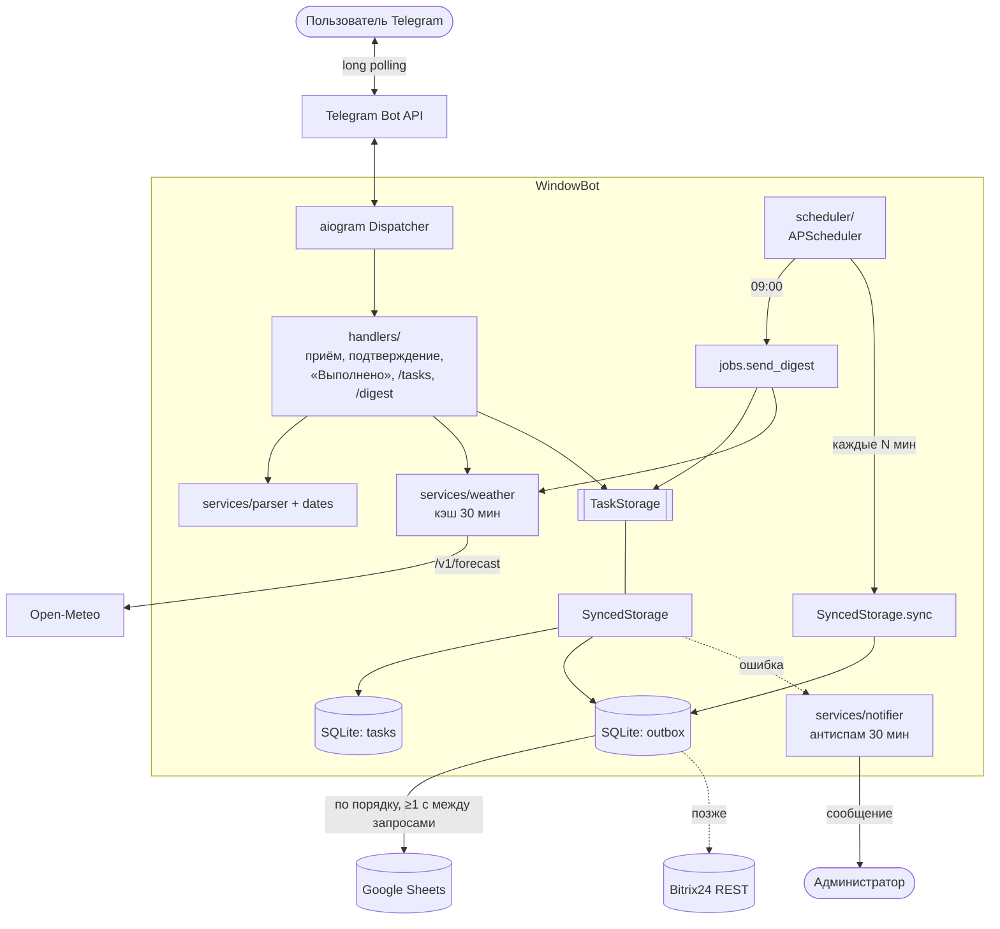
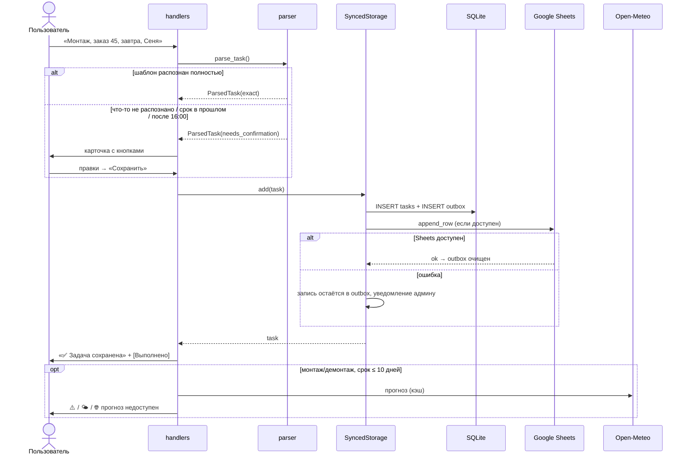

# WindowBot — отчёт по архитектуре и отказоустойчивости

1. [Что сделано](#1-что-сделано)
2. [Архитектура](#2-архитектура)
3. [Поведение при отказах](#3-поведение-при-отказах)
4. [План перехода на Bitrix24](#4-план-перехода-на-bitrix24)
5. [Известные ограничения](#5-известные-ограничения)

---

## 1. Что сделано

| Критерий готовности | Как выполнен | Чем проверен |
|---|---|---|
| «Покраска, заказ 123, срок пятница, ответственный Иван» сохраняется корректно | строгий regex-шаблон → `Task(Покраска, 123, пт 18:00, Иван)`; при неточном разборе — карточка подтверждения с инлайн-кнопками | `tests/test_parser.py`, `tests/test_handlers.py`, ручная проверка в Telegram + Google Sheets |
| Сводка в 9:00 разделяет просроченные и сегодняшние | `CronTrigger` APScheduler по часовому поясу сервера; разделы «Просрочено» / «На сегодня» | `tests/test_digest.py`, ручная проверка `/digest` |
| Предупреждение для «монтажа» при холодном прогнозе | Open-Meteo `/v1/forecast`, пороги из `.env`; при создании (срок ≤ 10 дней) и в сводке (сегодня/завтра) | `tests/test_weather.py`, живой запрос к Open-Meteo |
| Storage переключается через `.env` | `STORAGE_BACKEND=sheets\|sqlite`, выбор только в `storage_factory.py` | `tests/test_synced_storage.py`, запуск в обоих режимах |
| README позволяет поднять бота с нуля | установка Python, venv, BotFather, сервисный аккаунт Google, `.env`, автозапуск, FAQ | — |
| В репозитории нет секретов | `.env`, `credentials/`, `data/` в `.gitignore`; сканирование перед коммитом | проверка `git ls-files` |

Тесты: **123**, без обращений к сети (Telegram, Sheets и Open-Meteo подменены фейками).

---

## 2. Архитектура

### 2.1. Слои

```
Telegram ──► handlers/ ──► services/ (парсер, даты, погода, тексты)
                │
                ▼
          TaskStorage  ◄── scheduler/ (сводка 9:00, досылка очереди)
                │
     ┌──────────┴───────────┐
  SQLiteStorage        SyncedStorage
 (STORAGE_BACKEND=     (STORAGE_BACKEND=sheets)
     sqlite)            ├── SQLiteStorage  — локальная копия всех задач
                        ├── SQLiteOutbox   — очередь неотправленных операций
                        └── remote: TaskStorage
                              └── GoogleSheetsStorage  (→ Bitrix24Storage)
```

Ключевые решения:

- **Единый интерфейс `TaskStorage`** (`add`, `get`, `list_open`, `mark_done`). Хендлеры,
  сводка и планировщик знают только его. Реализации выбираются в одном месте —
  `services/storage_factory.py`.
- **Local-first + outbox.** Любая запись сначала фиксируется в SQLite и в очереди, и только
  потом уходит во внешнюю систему. Задача не теряется ни при каком сбое удалённого хранилища.
- **Удалённое хранилище — тоже `TaskStorage`.** Google Sheets и будущий Bitrix24 —
  взаимозаменяемые реализации; очередь, повторы, троттлинг и уведомления в `SyncedStorage`
  общие.
- **Единый тип ошибки `StorageError`.** Ошибки gspread / requests / google-auth / сети
  приводятся к нему — верхние слои не зависят от конкретной библиотеки.
- **Синхронные библиотеки (gspread, sqlite3) — в `asyncio.to_thread`**, чтобы не блокировать
  event loop бота.

### 2.2. Схема компонентов



### 2.3. Поток создания задачи



### 2.4. Модель данных

| Поле `Task` | SQLite `tasks` | Google Sheets | Bitrix24 (план) |
|---|---|---|---|
| `id` (8 hex, локальный) | `id` PK | `ID` | тег `wb-<id>` / поле `UF_WINDOWBOT_ID` |
| `work_type` | `work_type` | `Тип работ` | `TITLE` (префикс), тег типа |
| `order_no` | `order_no` | `Заказ` | `TITLE`, пользовательское поле `UF_ORDER_NO` |
| `due` | `due` | `Срок` | `DEADLINE` (ISO 8601 с часовым поясом) |
| `assignee` | `assignee` | `Ответственный` | `RESPONSIBLE_ID` (через справочник) |
| `status` | `status` | `Статус` | `STATUS` (5 = завершена) |
| `chat_id` | `chat_id` | `Chat ID` | пользовательское поле `UF_TG_CHAT_ID` |
| `external_id` | `external_id` | — | ID задачи Bitrix24 |

Таблица `outbox`: `id` (порядок), `task_id`, `op` (`create` / `mark_done`), `payload` (снимок
задачи), `attempts`, `last_error`, `created_at`.

---

## 3. Поведение при отказах

### 3.1. Google Sheets недоступен

Причины: нет сети, 5xx Google, исчерпана квота (60 запросов/мин на пользователя),
отозван доступ сервисного аккаунта (403), неверный ID таблицы (404), отключён Sheets API.

| Операция | Что происходит |
|---|---|
| Создание задачи | запись в SQLite и outbox → попытка отправки → `StorageError` → лог `ERROR`, админу «⚠️ Google Sheets недоступен: … в очереди: N», пользователь видит «✅ Задача сохранена» |
| «Выполнено» | статус меняется в SQLite сразу, операция `mark_done` встаёт в очередь **после** `create` той же задачи |
| `/tasks`, сводка | читаются из локальной SQLite (`list_open` → fallback) |
| Повторы | `outbox-sync` каждые `SYNC_INTERVAL_MINUTES` (по умолчанию 5), а также при каждой новой записи и при старте бота |
| Восстановление | очередь отправляется строго по порядку; админу «✅ снова доступен, отправлено N» |
| Антиспам | одно уведомление на инцидент, повтор не чаще раза в 30 минут |
| Дубли | `add` в Sheets идемпотентен — сначала ищет строку по `ID` |

Если Sheets недоступен при **старте** — бот всё равно запускается и работает локально.
Если отсутствует **файл ключа** — бот не стартует (это ошибка конфигурации, а не сбой).

**Что сделать администратору:** по тексту ошибки в уведомлении — проверить доступ
сервисного аккаунта к таблице, квоту в Google Cloud Console, статус
https://www.google.com/appsstatus. Ничего вручную досылать не нужно.

### 3.2. Open-Meteo недоступен

Причины: нет сети, 5xx, таймаут (10 с), изменился формат ответа.

| Где | Что происходит |
|---|---|
| Создание монтажа/демонтажа | задача **сохраняется как обычно**; вместо прогноза — «🌐 Прогноз погоды недоступен — проверьте позже»; в лог `WARNING` |
| Утренняя сводка | у задачи в разделе погоды — «🌐 прогноз недоступен»; сводка всё равно отправляется |
| Кэш | прогноз на 11 дней запрашивается одним запросом и хранится 30 минут — кратковременные сбои после успешного запроса незаметны |

Админу отдельное уведомление не отправляется: погода — вспомогательная функция и не влияет
на сохранность данных. **Что сделать:** проверить https://open-meteo.com/ (статус API),
при длительной недоступности — проверить погоду вручную для монтажей на ближайшие дни.

### 3.3. Telegram недоступен

| Ситуация | Что происходит |
|---|---|
| Нет связи с `api.telegram.org` | aiogram продолжает long polling с экспоненциальной паузой и сам переподключается; входящие сообщения Telegram хранит у себя до 24 часов и доставит после восстановления |
| Сбой при отправке ответа пользователю | задача к этому моменту уже сохранена; пользователь может проверить через `/tasks` |
| Сбой при отправке сводки в конкретный чат (бот заблокирован, чат удалён) | чат пропускается, остальные получают сводку; лог `WARNING` |
| Telegram недоступен в 9:00 | сводка в этот день **не досылается** (см. [ограничения](#5-известные-ограничения)); посмотреть можно `/digest` |
| Уведомление админу не ушло | ошибка логируется, бот продолжает работу |
| Запущено два экземпляра бота | `TelegramConflictError` в логе — оставить один процесс |

**Что сделать:** проверить сеть/фаервол сервера до `api.telegram.org:443`, валидность
токена (`TelegramUnauthorizedError` → перевыпустить в @BotFather).

### 3.4. Прочее

| Ситуация | Поведение |
|---|---|
| Перезапуск бота | сохранённые задачи и очередь в SQLite не теряются; неподтверждённые черновики (в памяти) — нужно прислать заново |
| Ошибка в `.env` | бот не стартует, в консоли — список неверных полей |
| Ручная правка таблицы | бот читает изменённые срок/статус; битые строки пропускает с `WARNING` |
| Неожиданная ошибка кода при синхронизации | запись остаётся в очереди с `last_error`, полный traceback в логе, админу — уведомление |

---

## 4. План перехода на Bitrix24

### 4.1. Цель и принцип

Задачи ставятся в Bitrix24 через REST API вместо (или вместе с) Google Sheets.
Принцип не меняется: **SQLite остаётся локальной копией и очередью**, Bitrix24 становится
новой реализацией удалённого `TaskStorage`. Хендлеры, парсер, сводка и погода не меняются.

### 4.2. Ограничения API Bitrix24, которые нужно учесть

| Ограничение | Значение | Как учитываем |
|---|---|---|
| Частота запросов (leaky bucket) | ~2 запроса/с на портал, «ведро» ~50 запросов; на тарифе Enterprise выше | `SyncedStorage(min_interval_s=0.5)` — уже реализованный троттлинг |
| Превышение лимита | HTTP 503 `QUERY_LIMIT_EXCEEDED` | считаем временной ошибкой → `StorageError`, запись остаётся в outbox, повтор с паузой |
| Пакетные запросы | метод `batch` — до 50 команд за один вызов | синхронизатор отправляет накопившуюся очередь пачками (размер пачки уже параметризован: `batch_size=50`) |
| Лимит времени выполнения методов | при длительной суммарной нагрузке на метод портал временно блокирует его | небольшие пачки, экспоненциальная пауза между неудачными попытками |
| Нет ключа идемпотентности | повтор `tasks.task.add` создаст дубль | перед повтором ищем задачу по тегу `wb-<id>`; после успеха сохраняем `external_id` |
| Права вебхука | входящий вебхук действует от имени создавшего его пользователя | отдельный технический пользователь, вебхук с правами только на «Задачи» и «Пользователи» |

Сверить актуальные лимиты своего тарифа перед запуском: документация Bitrix24 REST,
раздел про ограничения на количество запросов.

### 4.3. Что реализовать

**1. `bot/storage/bitrix24.py` — `Bitrix24Storage(TaskStorage)`** на `httpx` (уже в зависимостях):

| Метод интерфейса | Вызов Bitrix24 REST |
|---|---|
| `add(task)` | `tasks.task.list` с фильтром по тегу `wb-<id>` → если нет, `tasks.task.add` с `TITLE`, `DESCRIPTION`, `RESPONSIBLE_ID`, `DEADLINE`, `TAGS`, пользовательскими полями; вернуть `task` с `external_id` |
| `mark_done(id)` | `tasks.task.complete(taskId=external_id)` |
| `list_open()` | `tasks.task.list` с фильтром «не завершена» и тегом бота, постраничная выборка |
| `get(id)` | `tasks.task.get` |
| ошибки | 503/`QUERY_LIMIT_EXCEEDED`, 5xx, таймаут, сеть → `StorageError`; 401/403 → `StorageError` + отдельное уведомление «проверьте вебхук» |

**2. Справочник ответственных.** В тексте задачи — имя («Иван»), а Bitrix24 нужен
`RESPONSIBLE_ID`. Варианты (по возрастанию сложности):
- статический файл `assignees.json` (`{"Иван": 17, "Сеня": 23}`) + ответственный по умолчанию;
- кэш из `user.search` по имени, обновляемый раз в сутки;
- при неоднозначности — карточка подтверждения с кнопками выбора сотрудника (механизм
  карточек уже есть).

**3. Доработка очереди (`SQLiteOutbox`):**
- колонка `next_attempt_at` и экспоненциальная пауза (1 → 2 → 4 … → 30 мин) вместо
  фиксированного интервала — чтобы не «добивать» портал при превышении лимитов;
- отправка через `batch`: до 50 операций за запрос, разбор результата по каждой команде;
- «мёртвые» записи: после N (например, 20) неудач — пометка `dead`, уведомление админу с
  текстом ошибки, команда `/retry` для повторной отправки;
- `mark_done` для задачи, у которой ещё нет `external_id`, ждёт успешного `create`
  (порядок по `id` уже гарантирован).

**4. Конфигурация (`.env`):**

```
STORAGE_BACKEND=bitrix24
BITRIX24_WEBHOOK_URL=https://<портал>.bitrix24.ru/rest/<user_id>/<код>/
BITRIX24_DEFAULT_RESPONSIBLE_ID=1
BITRIX24_MIN_INTERVAL_S=0.5
```

Плюс ветка в `storage_factory.py` — единственное место, где появляется новый класс.

**5. Обратная синхронизация (по желанию).** Если задачи будут закрывать прямо в Bitrix24:
- простой вариант — `list_open()` уже читает актуальный статус из Bitrix24 перед сводкой;
- точный вариант — исходящий вебхук `OnTaskUpdate` → потребует публичный HTTPS-адрес
  у бота (сейчас бот работает через long polling и входящих адресов не имеет).

### 4.4. Этапы перехода


| Этап | Действия | Критерий перехода |
|---|---|---|
| **0. Подготовка** | технический пользователь и входящий вебхук в Bitrix24; пользовательские поля `UF_ORDER_NO`, `UF_TG_CHAT_ID`; справочник ответственных; `Bitrix24Storage` + тесты на фейковом HTTP (как для Open-Meteo) | тесты зелёные, ручная постановка задачи на тестовом портале |
| **1. Теневой режим** | `SyncedStorage` пишет в Sheets (основной) **и** в Bitrix24 (вторая очередь) — `CompositeRemote` с отдельной outbox на каждое направление; читаем из Sheets | 1–2 недели без расхождений, нет зависших записей в очереди Bitrix24 |
| **2. Переключение** | перенос открытых задач: `list_open()` из Sheets → `Bitrix24Storage.add()` пачками по 50 с паузой (идемпотентно, можно перезапускать); `STORAGE_BACKEND=bitrix24` | число открытых задач совпадает, сводка корректна |
| **3. Отключение Sheets** | убрать двойную запись; таблица остаётся архивом только для чтения | — |

**Откат** на любом этапе — вернуть `STORAGE_BACKEND=sheets`: локальная SQLite содержит все
задачи, а очередь дошлёт изменения, накопленные за время работы с Bitrix24.

### 4.5. Оценка нагрузки

При типичной нагрузке (десятки задач в день) бот делает единицы запросов в минуту —
далеко от лимита 2 запроса/с. Лимиты становятся важны в двух случаях, и оба уже покрыты:
- **первичный перенос** большого числа задач — пачки по 50 через `batch` с паузой;
- **досылка очереди после долгой недоступности** портала — порядок, троттлинг и
  экспоненциальная пауза в outbox.

---

## 5. Известные ограничения

| Ограничение | Последствие | Как улучшить |
|---|---|---|
| Черновики (неподтверждённые задачи) хранятся в памяти | после перезапуска их нужно прислать заново | FSM-хранилище в SQLite/Redis |
| Сводка не досылается, если Telegram недоступен ровно в 9:00 | в этот день сводки нет (есть `/digest`) | повтор отправки с паузой / отметка «сводка за дату отправлена» в SQLite |
| Одни координаты погоды на все задачи | для объектов в разных городах прогноз неточен | адрес/координаты в задаче или в заказе |
| Задачи, закрытые вручную в Google Sheets, при недоступности Sheets показываются по локальной копии | при сбое Sheets такая задача может попасть в сводку как открытая | периодически обновлять локальную копию из удалённого хранилища |
| Нет защиты от запуска двух экземпляров | `TelegramConflictError`, сообщения обрабатываются вперемешку | файл-блокировка в `data/` при старте |
| Сроки и сводка — по часовому поясу сервера, прогноз — по часовому поясу точки | расходятся, если сервер в другом поясе (сейчас оба `Asia/Yekaterinburg`) | явная переменная часового пояса в `.env` |
